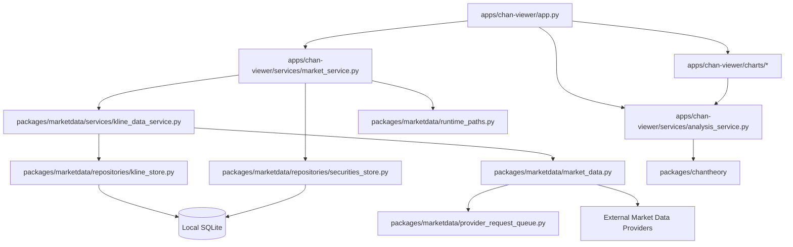

# StockPilot Component View: Market Data And K-Line Flows

This document focuses on the shared market-data path under `packages/marketdata`
and how the Chan analysis debug app consumes it.

## Scope

This view covers:

- market-data provider access
- local SQLite-backed K-line and securities storage
- the shared K-line service
- Chan analysis invocation from the app side

## Component View

## Responsibilities

### UI Components

- `apps/chan-viewer/app.py` collects user input and renders results.
- `market_service.py` adapts the app to the shared K-line and securities services.
- `analysis_service.py` is a thin wrapper around `packages/chantheory`.
- `charts/*` turn stable analysis output into Plotly-friendly rendering.

### Shared Application Services

- `packages/marketdata/services/kline_data_service.py` is the key coordination
  point for K-line retrieval.
- It implements the local-first pattern: read from SQLite, fetch remotely if
  needed, write back, then return a normalized local result.
- `packages/marketdata/services/securities_search_service.py` provides code,
  name, and pinyin search over the securities master data.

### Infrastructure Components

- `packages/marketdata/market_data.py` owns remote market-provider integration.
- `packages/marketdata/provider_request_queue.py` serializes provider requests
  through one process-wide queue.
- `packages/marketdata/repositories/kline_store.py` owns SQLite reads and writes
  for K-line persistence.
- `packages/marketdata/repositories/securities_store.py` imports the committed
  `securities_master.json` into SQLite for search.
- `packages/marketdata/build_securities_master.py` regenerates
  `securities_master.json` from AkShare and the maintained HK static list. Run it
  from the repository root with
  `python -m packages.marketdata.build_securities_master`; the `-m` form is
  required because the script imports `packages.marketdata` and must work
  without an editable install.
- `packages/marketdata/runtime_paths.py` resolves local runtime directories.

### Domain Component

- `packages/chantheory` owns analysis contracts and structure mapping.
- It does not fetch remote data or manage persistence itself.

## Dependency Rules

- UI components do not call remote providers directly.
- UI components do not talk to SQLite directly.
- `chantheory` does not depend on runtime paths, providers, or storage code.
- The shared K-line service is the convergence point between apps and market
  providers.
